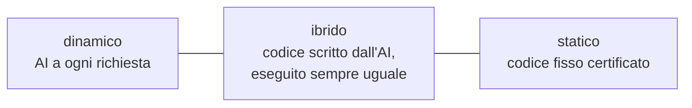

# Livelli di dinamicità

Per ogni parte dell'azienda si sceglie quanto può cambiare da sola. La scelta si registra in `azienda.json` nel campo `dinamicita`, con il motivo.

## I tre livelli

| Livello | A run time | Chi scrive il codice | Quando sceglierlo |
|---|---|---|---|
| **dinamico** | L'AI genera la risposta ogni volta | Nessun codice fisso: l'AI lavora sul cervello | Linguaggio, consulenza, spiegazioni, contenuti, interfacce; errori correggibili |
| **ibrido** | Gira codice deterministico, sempre uguale | L'AI lo scrive e lo aggiorna; una persona approva i casi di test | Prezzi, preventivi, idoneità, pratiche, configuratori, agende |
| **statico** | Gira codice fisso, certificato | Scritto e verificato una volta; nessuna AI lo modifica in esercizio | Macchinari, sicurezza, controllo di processo, pagamenti critici, ATM |



## Come decidere

Una parte è **statica** se anche una sola risposta è sì:

1. Un errore può ferire qualcuno o danneggiare un macchinario?
2. Serve una certificazione che vieta modifiche non verificate?
3. Deve rispondere in tempi garantiti, sotto il secondo, senza eccezioni?

Altrimenti è **ibrida** se anche una sola risposta è sì:

1. Deve dare sempre lo stesso risultato con lo stesso input?
2. Muove denaro, crea un contratto o un obbligo?
3. Serve rifare il calcolo a distanza di tempo per un controllo?

Altrimenti può essere **dinamica**.

## Esempi

| Parte | Livello | Motivo |
|---|---|---|
| Rispondere alle domande dei clienti sulle coperture | dinamico | Linguaggio, nessun effetto irreversibile |
| Calcolare il premio di una polizza | ibrido | Stesso input, stesso prezzo; contratto |
| Pianificare i turni del magazzino | ibrido | Regole precise, rifacibile e controllabile |
| Comandare il carroponte | statico | Sicurezza delle persone |
| Erogare contanti da un ATM | statico | Denaro e certificazione |

## Il livello cambia nel tempo

Le AI migliorano, e arriveranno robot generalisti capaci di adattarsi. Una parte statica oggi può diventare ibrida domani, e una ibrida dinamica. Il Blueprint lo prevede:

* ogni scelta ha un **motivo** scritto;
* si rivede almeno una volta l'anno;
* il passaggio di livello è una decisione approvata dal responsabile della parte, mai un effetto collaterale.

## Nel file dell'azienda

```json
"dinamicita": [
  { "parte": "Risposte ai clienti", "livello": "dinamico", "motivo": "Linguaggio, nessun effetto irreversibile" },
  { "parte": "Tariffe di deposito", "livello": "ibrido", "motivo": "Stesso input, stesso prezzo" },
  { "parte": "Comando dei carrelli automatici", "livello": "statico", "motivo": "Sicurezza delle persone" }
]
```
